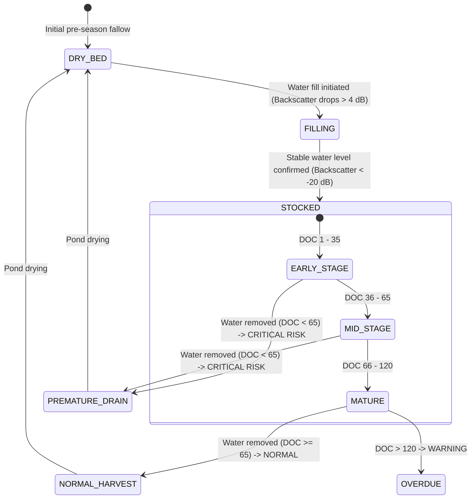

# AquaSentinel: All-Weather Aquaculture (Shrimp) Pond Intelligence

A production-grade satellite analytics engine for **shrimp feed manufacturers, hatcheries, seafood exporters, and aquaculture input-credit lenders** in India, built entirely on open **Sentinel-1 + Sentinel-2 + NISAR** data.

---

## 1. Commercial Context & Problem

India is the global leader in farmed *Litopenaeus vannamei* shrimp exports, generating over **\$5 Billion** annually. The industry is geographically clustered in coastal **Andhra Pradesh** (West Godavari, Krishna, Bapatla, Nellore), **Gujarat** (Surat, Navsari), and **Odisha**.

Feed manufacturers (Avanti Feeds, CP India, Godrej Agrovet, Grobest, Apex Frozen Foods, Devi Seafoods) and input dealers extend **₹2–5 Lakhs per hectare in seasonal unsecured credit** for feed, probiotics, and seed per crop cycle.

### The Core Financial Risks
1. **Unreported Disease & Early Harvest:** When White Spot Syndrome Virus (WSSV) or EHP strikes, farmers emergency-drain their ponds at 30–50 Days of Culture (DOC), selling undersized shrimp for cash to informal buyers without notifying the feed dealer or lender.
2. **Ghost Ponds & Loan Diversion:** Lenders and feed companies lack independent ground truth to verify if a loan-funded pond was actually filled or left fallow.
3. **Monsoon & Coastal Cloud Blindness:** Optical satellites (Sentinel-2, Landsat) are completely blinded by coastal monsoon rain and fog from June to October — the exact period when disease risk and feed consumption peak.

---

## 2. Satellite Radar Physics: Why SAR Solves This

Synthetic Aperture Radar (SAR) emits microwave pulses that penetrate clouds, rain, smoke, and nighttime.

```
RADAR BEAM (SAR)                 RADAR BEAM (SAR)
      \                                \
       \                                \
        v                                v  (Specular bounce away)
[ ROUGH DRY SOIL ]               ~~~~~~~~~~~~~~~~~~~~~ [ WATER SURFACE ]
 ^    ^    ^    ^
 |    |    |    |                                (NO RETURN TO SENSOR)
Diffuse backscatter returned                    Signal lost to sensor
==> BRIGHT in SAR (-12 to -15 dB)              ==> PITCH BLACK in SAR (<-21 dB)
```

### Backscatter Signatures Across Cycle

| Pond State | Sentinel-1 $\sigma^0_{VV}$ | NISAR $\sigma^0_{HH}$ | Optical Indicator (Sentinel-2) | Physical Mechanism |
| :--- | :--- | :--- | :--- | :--- |
| **Dry Bed (Pre-stocking / Sun-drying)** | $-12\text{ to }-15\text{ dB}$ | $-14\text{ to }-18\text{ dB}$ | High NIR/SWIR reflectance, low NDWI | Rough soil surface scattering from tilled pond bed. |
| **Filled & Stocked (Active Culture)** | **$<-20\text{ dB}$** | **$<-23\text{ dB}$** | High NDWI ($>0.3$), low NIR | Specular reflection: radar energy reflects away from satellite. |
| **Active Aeration (Paddle wheels)** | $-16\text{ to }-19\text{ dB}$ | $-18\text{ to }-21\text{ dB}$ | High turbidity, visible foam | Surface chop and capillary waves increase radar return slightly over still water. |
| **Sudden Drainage / Emergency Harvest** | **$+6\text{ to }+10\text{ dB}$ jump** in $<72\text{ h}$ | **$+6\text{ to }+9\text{ dB}$ jump** in $<72\text{ h}$ | Receding waterline, exposed mud | Water disappears; exposed wet mud bed suddenly boosts radar return. |

### The Combined Sentinel-1 + NISAR Advantage
- Sentinel-1 C-band revisits every 6–12 days.
- NISAR L-band revisits every ~6 days (ascending + descending).
- **Combined All-Weather Cadence: One SAR observation every ~3–4 days**, guaranteeing rapid detection of overnight pond drainage.

---

## 3. Pond Lifecycle State Machine



### Risk Classification
- **`CRITICAL`**: Pond was stocked and drained prematurely ($\text{DOC} < 65\text{ days}$). Indicates disease emergency harvest or dyke breach. High probability of credit default.
- **`WARNING`**: Pond has been in continuous culture for $> 120\text{ days}$ without harvest (overdue/stagnant), or water level fluctuates irregularly.
- **`NORMAL`**: Pond actively stocked with regular culture progression, or harvested normally at $\text{DOC} \ge 65\text{ days}$.
- **`FALLOW`**: Dry bed for $> 60\text{ days}$.

---

## 4. Python API & Usage

### 1. Audit a Single Pond by Coordinates or History
```python
from sentinel_tool.aquaculture import audit_pond_observations, PondObservation

# List of chronological SAR observations
observations = [
    PondObservation("2025-06-01", "S1", "VV", -13.5),  # dry
    PondObservation("2025-06-08", "S1", "VV", -22.1),  # filled (Stocked Day 1)
    PondObservation("2025-07-15", "NISAR", "HH", -23.4), # stocked (Day 38)
    PondObservation("2025-07-22", "S1", "VV", -14.2),  # suddenly drained on Day 45!
]

result = audit_pond_observations(
    pond_id="AP-WG-001",
    farmer_name="V. Rama Rao",
    observations=observations,
    as_of_date="2025-07-25",
)

print(result.risk_level)         # RiskLevel.CRITICAL
print(result.summary)            # "CRITICAL: Premature drainage detected at DOC 45..."
```

### 2. Run the Benchmark Audit CLI
```bash
# Generate synthetic benchmark and audit the Bhimavaram cluster (50 ponds)
python aquaculture.py --benchmark --count 50 --export-report outputs/bhimavaram_audit.json

# Audit a specific coordinate
python aquaculture.py --lat 16.544 --lon 81.523 --pond-id AP-WG-101
```

---

## 5. Commercial Deliverables

1. **Premature Harvest Early-Warning Alert (WhatsApp / Webhook):** Immediate notice whenever a farmer's pond is drained prior to Day 65.
2. **Dealer Portfolio Dashboard:** Real-time web map & sortable table of all customer ponds and their current Days of Culture.
3. **Weekly Monday Audit Report (PDF/Excel):** Summary of active, drained, and fallow ponds across the dealership cluster.
4. **Pre-Season Credit Scorecard:** 3-year historical reliability score for loan underwriting.
